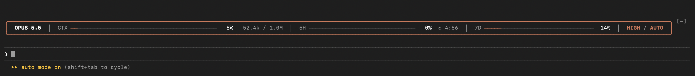
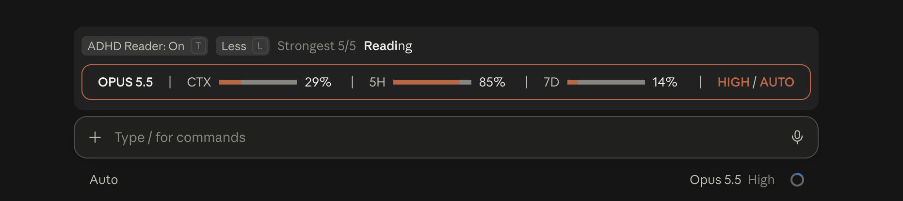

# context-gauge

A Claude Code mod that puts a one-line status card above the prompt.

**In the terminal**



**In the Claude desktop app**



The card shows:

- **Model** in use
- **CTX**: how full the context window is, with tokens used / window size
- **5H / 7D**: how much of your 5-hour and 7-day usage limits you've used (subscription plans),
  and how long until the 5-hour window resets (`↻1h20m`)
- **Effort / mode**: the current effort level and permission mode

Percentages turn amber at 70% and red at 90%. Colors follow your Claude Code theme, so the card
reads on light themes as well as dark ones.

## Narrow windows

The card always stays on one line. As the window narrows it drops the token count and reset
time first, then the bars, and keeps the percentages, effort and mode:

```
OPUS 5.5  │  CTX ━━━━━━━━━━━━━━━   5%   48.1k / 1.0M  │  5H ━━━━━━━━━━━  62%  ↻1h20m  │  7D ━━━━━━━━━━━  45%  │  HIGH / AUTO
OPUS 5.5 │ CTX ━━━━━━━━━━━━━━━   5% │ 5H ━━━━━━━━━━━  62% │ 7D ━━━━━━━━━━━━  45% │ HIGH / AUTO
OPUS 5.5 │ CTX ━━━━━━━   5% │ 5H ━━━━━  62% │ 7D ━━━━━━  45% │ HIGH / AUTO
OPUS 5.5  │  CTX  5%  │  5H 62% │ 7D 45% │ HIGH / AUTO
```

In the desktop app the same row is laid out to fit the window's font, with thin bars.

## Known limits

- **Mode after Shift+Tab** updates with your next prompt or tool call: Claude Code raises no
  event for the key itself.
- **Effort** shows `—` until Claude's first request in a session, unless it's saved in your
  settings (`/effort` saves it).
- **5H / 7D** show `—` until Claude Code has a reading, usually after the first request, and
  only on subscription plans.
- The `[-]` beside the card is Claude Code's own collapse button; the mod can't hide it.

## Install

In a Claude Code terminal session, run:

```
/plugin install context-gauge --marketplace krushna-pawar/context-gauge
```

Answer `y` to add the marketplace, then press Enter to install for your user. The card shows up
right away and in every new session.

## Develop

```sh
claude plugin validate .
claude plugin test .
```

After changing the code, bump `version` in `.claude-plugin/plugin.json` and run
`claude plugin marketplace update context-gauge && claude plugin update context-gauge@context-gauge`.

## License

MIT, see [LICENSE](LICENSE).
