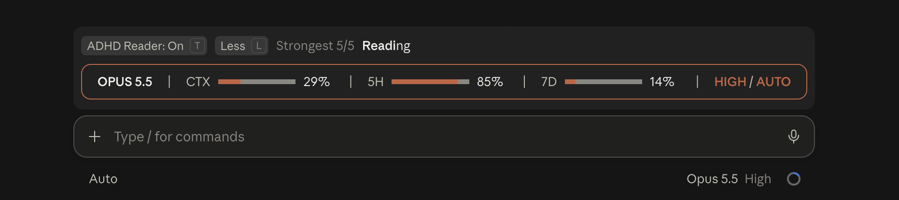

# context-gauge

A Claude Code mod that shows the model, context window and usage limits beside the prompt.

**In the terminal**: one line under the prompt, at the right of Claude Code's own hint row. It adds
no rows.

```
❯
────────────────────────────────────────────────────────────────────────────────────────────
  ⏸ manual mode on · ? for shortcuts                 OPUS 5.5  ctx ━━━━━━ 5%  5h 62%  7d 45%
```

**In the Claude desktop app** (and the VS Code panel): a one-line card above the prompt.



Both show:

- **Model** in use. In the terminal it is Claude orange, which marks what you can click: click it to open Claude Code's model picker, the one `/model`
  opens; the effort slider is in there too
- **ctx**: how full the context window is, as a bar and a percentage (the card adds tokens used /
  window size)
- **5h / 7d**: how much of your 5-hour and 7-day usage limits you've used (subscription plans)

The card also shows the effort and the permission mode. The terminal line leaves the mode to
Claude Code's own hint beside it, and shows the effort only if you turn it on (see Settings).

Colors follow your Claude Code theme, so the gauges read on light themes as well as dark ones.

## Quiet until it matters

In the terminal the readings are as grey as Claude Code's own hints, so they stay out of the way:

```
OPUS 5.5  ctx ━━━━━━ 5%  5h 62%  7d 45%                            under 75%: grey
OPUS 5.5  ctx ━━━━━━ 23%  5h 78% resets in 0:52 at 3:40pm  7d 47%  from 75%: bold, and 5h says when it resets
OPUS 5.5  ctx ━━━━━━ 41%  5h 96% resets in 0:21 at 3:40pm  7d 58%  from 95%: Claude orange
```

- **Under 75%**: grey.
- **From 75%**: that reading turns plain, its percentage bold. 5h also says when it resets: how
  long from now (hours:minutes) and at what time (`3:40pm`, or `15:40` on a 24-hour clock).
- **From 95%**: its percentage turns Claude orange. No red and no block of color, so it doesn't
  nag once you already know.

On the card, percentages turn red at 90%.

## Settings

Run `/config` and look for context-gauge. They all change the terminal line:

| Setting | Default | What it does |
| --- | --- | --- |
| Show model name | on | Shown in orange; click it to switch models |
| Show effort level | off | Click it to change effort |
| Show weekly limit (7d) | on | How much of your weekly limit you've used |
| 5h reset time format | in 0:52 at 3:40pm | Or `at 3:40pm`, or `in 0:52` |
| Always show 5h reset time | off | Off: it appears only once 5h reaches the highlight level |
| Clock format | auto | 12-hour (3:40pm) or 24-hour (15:40); auto follows your computer |
| Time zone | empty | Empty uses your computer's; or a name such as `Asia/Kolkata` |
| Highlight from (%) | 75 | Usage turns bold from here |
| Warn from (%) | 95 | Usage turns orange from here |

## Narrow windows

The terminal line never wraps and keeps clear of Claude Code's hint. As the window narrows it
drops the reset's time of day first, then the model, then the bar, then the countdown, then 7d,
then 5h:

```
OPUS 5.5  ctx ━━━━━━ 5%  5h 78% resets in 0:52 at 3:40pm  7d 45%
OPUS 5.5  ctx ━━━━━━ 5%  5h 78% resets in 0:52  7d 45%
ctx ━━━━━━ 5%  5h 78% resets in 0:52  7d 45%
ctx 5%  5h 78% resets in 0:52  7d 45%
ctx 5%  5h 78%  7d 45%
ctx 5%  5h 78%
ctx 5%
```

Narrower still, the row is left to Claude Code.

In the desktop app and the VS Code panel the card fills the width, with thin bars taking the spare
room. On a narrow pane, as in VS Code's sidebar or a small window, it takes two rows: the model and
effort / mode, then the gauges without bars.

## Known limits

- **5h / 7d** show `—` until Claude Code has a reading, usually after the first request, and
  only on subscription plans.
- **Effort** (where shown) is `—` until Claude's first request in a session, unless it's saved in
  your settings (`/effort` saves it).
- **Clicks** need a terminal that passes the mouse to Claude Code. During a turn, the picker opens
  once the turn ends. Where the window is too narrow for the model, there is nothing to click;
  `/model` still works.
- **The reset's time of day** is told in the time zone of the machine Claude Code runs on. Over
  SSH or in a cloud session that is often UTC, not yours: the line then says `at 7:00pm UTC`. Set
  Time zone to get your own. The countdown beside it is right everywhere.
- **The terminal line** can't see how long Claude Code's hint beside it is. It leaves the room
  that hint needs at its shortest in the current permission mode; where the hint is longer, or
  you changed mode with Shift+Tab since your last prompt, Claude Code shortens its hint.
- **Mode after Shift+Tab** (the card) updates with your next prompt or tool call: Claude Code
  raises no event for the key itself.
- The `[-]` beside the card is Claude Code's own collapse button; the mod can't hide it.

## Install

In a Claude Code terminal session, run:

```
/plugin install context-gauge --marketplace krushna-pawar/context-gauge
```

Answer `y` to add the marketplace, then press Enter to install for your user. The gauges show up
right away and in every new session.

## Develop

```sh
claude plugin validate .
claude plugin test .
```

After changing the code, bump `version` in `.claude-plugin/plugin.json` and run
`claude plugin marketplace update context-gauge && claude plugin update context-gauge@context-gauge`.

## License

MIT, see [LICENSE](LICENSE).
